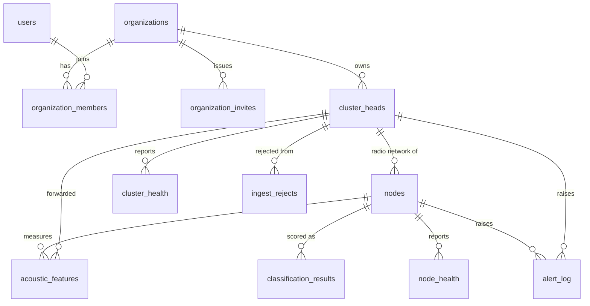

# NAKHEL Database

PostgreSQL 17 + TimescaleDB 2.31.0, in Docker. One database and one schema shared by all organizations; row-level security keeps them apart.

## Quick start

Needs only bash and Docker.

```bash
./db.sh reset          # delete the dev database and rebuild it from zero
./db.sh seed           # 2 organizations, 30 days of fake data (about 1 minute)
./db.sh test           # all database tests, on a throwaway database
./db.sh psql           # SQL shell as the owner role
./db.sh seed --scale   # optional: 8,000 nodes x 90 days (10+ minutes, about 4 GB)
```

Seed logins: `owner@al-ain-demo.example`, `owner@oasis-palm-demo.example` and `consultant@nakhel-demo.example` (belongs to both). The password is `nakhel-dev-password`.

### Browse with a GUI (DBeaver or pgAdmin)

| Setting | Value |
|---|---|
| Host, port | `127.0.0.1`, `5433` (if the server is remote: `ssh -L 5433:127.0.0.1:5433 <server>`, then the same) |
| Database | `nakhel` |
| User, password | `nakhel_owner`, from `.env` |

The owner role sees every organization. To see what the app sees, connect as `nakhel_web` and run these together, in one transaction:

```sql
BEGIN;
SELECT set_config('app.current_org', '<org uuid>', true);
SELECT * FROM node_status;
COMMIT;
```

Without `set_config`, `nakhel_web` sees zero rows. That's the design working.

## Entity relationships



Every link between tenant tables is a composite foreign key that includes `org_id`, so a row can't claim one organization while pointing at another's node. `classification_results` and `acoustic_features` join on `(node_id, timestamp)`, with no foreign key.

## Tables

All times are `timestamptz`, stored in UTC. Display uses the organization's time zone.

### Tenancy

**organizations** · kept forever
| Column | Type | Meaning |
|---|---|---|
| org_id | uuid PK | |
| name | text | Display name |
| slug | text unique | URL segment. Lower-case words and hyphens; route names are reserved |
| timezone | text | IANA name, checked against the server's list. Default `Asia/Dubai` |
| suspect_threshold | numeric 0–1 | Last-3 average at or above this = suspected. Default 0.5 |
| alert_threshold | numeric 0–1 | At or above this = alert. Default 0.8. Must be above suspect_threshold |
| created_at | timestamptz | |

**users** · kept forever. Global: one person can belong to several organizations.
| Column | Type | Meaning |
|---|---|---|
| user_id | uuid PK | |
| email | text unique | Always lower-case |
| name | text | |
| password_hash | text | argon2id PHC string. Not readable by app roles, except through `auth_user_by_email` at login |
| token_version | int | Raised on password change, which ends existing sessions |
| created_at, last_login | timestamptz | |

**organization_members** · PK (org_id, user_id)
| Column | Type | Meaning |
|---|---|---|
| org_id, user_id | uuid FK | |
| role | text | `owner` is the only value for now |
| created_at | timestamptz | |

Triggers refuse removing the last owner, and refuse committing a new organization that has no owner.

**organization_invites**
| Column | Type | Meaning |
|---|---|---|
| invite_id | uuid PK | |
| org_id | uuid FK | |
| email | text | Who it's for, lower-case |
| role | text | Default `owner` |
| token_hash | text unique | SHA-256 hex of the emailed token. Not readable by app roles |
| invited_by | uuid FK users | |
| created_at, expires_at, accepted_at | timestamptz | `accepted_at` set = used |

### Devices

**cluster_heads** · kept forever
| Column | Type | Meaning |
|---|---|---|
| cluster_id | uuid PK | |
| org_id | uuid FK | |
| name | text | E.g. `CH-01`, unique per organization |
| farm_zone | text | Free-text label |
| install_date | date | |
| location_lat, location_lon | double | Degrees |
| uplink_type | text | `wifi` or `4g` |
| api_key_hash | text unique | SHA-256 hex of the API key. Not readable by app roles |
| api_key_created_at | timestamptz | |
| revoked | boolean | A revoked key stops matching in `ingest_auth` |

**nodes** · one per tree, kept forever
| Column | Type | Meaning |
|---|---|---|
| node_id | bigint PK | Internal ID used everywhere in the database |
| org_id, cluster_id | FK | Composite FK to cluster_heads |
| lora_id | int 0–255 | The radio's 1-byte ID, so at most 256 nodes per cluster head. Unique among active nodes per cluster head, so **never treat this as a node ID** |
| tree_label | text | E.g. `PLM-A-07` |
| farm_zone | text | |
| install_date | date | |
| location_lat, location_lon | double | Degrees |
| active | boolean | False = retired; history is kept and its LoRa ID can be reused |
| updated_at | timestamptz | |

### Time series (hypertables, 7-day chunks)

**acoustic_features** · 1 year · unique (node_id, timestamp)
| Column | Type | Meaning |
|---|---|---|
| timestamp | timestamptz | When the node recorded the sample |
| org_id, node_id, cluster_id | FK | Internal IDs |
| mfcc | real[][] | 30 frames × 13 coefficients, all finite |
| snr_db | real, nullable | Decibels |
| rssi_dbm | int, nullable | dBm |
| msg_id | uuid, nullable | Row ID in the Pi's SQLite buffer |
| received_at | timestamptz, nullable | When the Pi received the LoRa packet |
| schema_version | smallint | Payload version, default 1 |
| ingested_at | timestamptz | Set by the server |
| energy | real, generated | Mean of c0 over the frames, a log-energy value with no fixed scale (decision A4) |
| status | text | `pending`, `classified` or `failed`. Always starts `pending` |

**classification_results** · 1 year · unique (node_id, timestamp, model_version)
| Column | Type | Meaning |
|---|---|---|
| timestamp | timestamptz | Of the measurement, not the inference |
| org_id, node_id | FK | |
| label | text | `healthy` or `infested` |
| confidence | real 0–1 | **P(infested), whatever the label** (decision A1) |
| model_version | text | |
| inference_ms | real | Milliseconds |
| processed_at | timestamptz | When the worker finished |

**node_health** · 1 year · unique (node_id, timestamp). Empty until the heartbeat exists.
| Column | Type | Meaning |
|---|---|---|
| timestamp | timestamptz | |
| org_id, node_id | FK | |
| battery_mv | int | Millivolts |
| rssi_dbm | int | dBm |
| uptime_s | bigint | Seconds |

**cluster_health** · 1 year · unique (cluster_id, timestamp)
| Column | Type | Meaning |
|---|---|---|
| timestamp | timestamptz | |
| org_id, cluster_id | FK | |
| uptime_s | bigint | Seconds |
| rssi_dbm | int | dBm |
| sd_free_mb | int | Megabytes |
| uplink_type | text | `wifi` or `4g` |
| buffered_count | int | Messages waiting in the Pi's buffer |

**ingest_rejects** · 90 days · 30-day chunks
| Column | Type | Meaning |
|---|---|---|
| time | timestamptz | |
| org_id, cluster_id | FK | From the API key |
| lora_id | int, nullable | As sent, if it could be parsed; deliberately not range-checked |
| http_status | smallint | 400–499 |
| error_code | text | E.g. `unknown_node` |
| request_body | text, nullable | Up to 64 KB |

### Alerts

**alert_log** · regular table, kept forever
| Column | Type | Meaning |
|---|---|---|
| alert_id | bigint PK | |
| org_id | uuid FK | |
| timestamp | timestamptz | When the condition happened |
| created_at | timestamptz | When the engine raised it |
| measurement_ts | timestamptz, nullable | The measurement that triggered it, for latency |
| node_id / cluster_id | FK, nullable | Cluster alerts need a cluster head; all others need a node |
| alert_type | text | `infestation_detected`, `infestation_suspected`, `node_offline`, `low_battery`, `cluster_offline`, `sd_low` |
| severity | text | `critical`, `warning`, `info` |
| confidence | real 0–1, nullable | Last-3 average, for infestation alerts |
| message | text | |
| acknowledged, acknowledged_by, acknowledged_at | | All set or all empty |
| email_sent_at | timestamptz, nullable | |

**node_current** · one row per node, written only by triggers. Latest classification and heartbeat state, read through `node_status`. See "Speed on the large seed" below.

### `node_status` view

The one definition of tree status. It has one row per **active** node, and row-level security applies to it.

| Status | Rule, first match wins |
|---|---|
| `offline` | Has heartbeats, and the latest is over 56 h old |
| `unknown` | No classifications yet |
| `alert` | Last-3 average ≥ the organization's alert_threshold |
| `suspected` | Last-3 average ≥ the organization's suspect_threshold |
| `healthy` | Otherwise |

A node with no health data at all is never offline: with SNR gating, silence proves nothing.

## Tenancy and row-level security

1. Every tenant table carries `org_id`, with the policy `org_id = current_org_id()`.
2. The app runs `SELECT set_config('app.current_org', <uuid>, true)` at the start of each transaction. `true` makes it local to the transaction, the same as `SET LOCAL`, and unlike `SET LOCAL` it accepts a parameter.
3. No setting means no rows, and writes are refused. This also holds after a previous transaction's setting has ended on a pooled connection.
4. The composite foreign keys stop mismatched rows even for roles that skip RLS.

### What bypasses row-level security

| Path | Why |
|---|---|
| `ingest_auth(key_hash)` | API key → cluster head and organization |
| `auth_user_by_email(email)` | Login: the only way the web role can read a password hash |
| `auth_memberships(user_id)` | The user's organizations |
| `invite_by_token(token_hash)` | Open an invite link |
| Last-owner and first-owner triggers | Must count all owners |
| `node_current` triggers | Must write a table app roles can only read. Not callable by app roles directly |
| `nakhel_worker` | Has `BYPASSRLS`; serves every organization |
| `nakhel_owner` | Owns the tables, so isn't subject to their policies. Runs migrations and scripts; the app never connects as it |

A test fails if a new `SECURITY DEFINER` function appears, or if a table with `org_id` has no policy.

### TimescaleDB chunks

Rows physically live in hidden chunk tables, which get the hypertable's GRANTs but not its RLS. Migration 0008 removes the app roles' grants from chunks through a job that runs every minute. Access through the hypertable is unaffected. A new chunk can stay exposed for up to a minute, but only to SQL that names it directly. See decision N4.

## Roles

| Role | Used by | Can |
|---|---|---|
| `nakhel_owner` | Migrations, seed, admin scripts | Owns the schema. Not a superuser |
| `nakhel_web` | Next.js, subject to RLS | Read its organization. Insert measurements, health and rejects. Acknowledge alerts. Manage settings, members, invites, cluster heads, nodes. Can't delete measurements, or write classifications |
| `nakhel_worker` | Python worker, `BYPASSRLS` | Read features and metadata, update `status`, write classifications and alerts, stamp `email_sent_at`. Can't read any password, key or token hash |

The exact privileges are in `db/migrations/0007_grants.sql`, and `db/tests/test_roles.py` checks them cell by cell.

## Retention

| Data | Kept |
|---|---|
| acoustic_features, classification_results | 1 year (report) |
| node_health, cluster_health | 1 year (report is silent; default) |
| ingest_rejects | 90 days (assumed) |
| alert_log, tenancy, devices | Forever |

## Queries

`db/queries/` has one file per dashboard need. Each states its parameters and columns in a header, and tests check that it runs, returns those columns, and leaks nothing across organizations. Every dashboard query filters on `org_id = current_org_id()`.

### Speed on the large seed

Measured with `./db.sh bench` as `nakhel_web`, on 8,000 nodes and 1.1 million measurements, on a shared 2-CPU / 7.8 GB server. Target: under 200 ms (assumed; see Q-PERF in PLAN.md).

| Query | First version (ms) | With `node_current` (ms) |
|---|---|---|
| alerts | 4.4 | 2.4 |
| classification_history | 27.9 | 1.6 |
| classification_latest | 504 | 29.5 |
| cluster_health | 3.7 | 3.8 |
| energy_node | 3.5 | 1.7 |
| energy_overview | 694 | 376, then rewritten; **rewrite not yet timed at this size** |
| historical_records | 14.4 | 9.9 |
| map_clusters | 4.3 | 4.3 |
| map_nodes | 296 | 39.7 |
| node_health | 237 | 26.8 |
| summary_cards | 333 | 131 |
| tree_cards | 221 | 30.2 |
| tree_detail | 4.5 | 1.3 |

Medians of 7 runs. These timings predate the 512 MB `shared_buffers` cap, and the second column was on data loaded before the triggers existed. Re-run with `./db.sh seed --scale && ./db.sh bench` (10+ minutes, about 4 GB of disk).

`node_current` holds the latest state per node so that status doesn't need a look into every chunk for every node. Triggers on `nodes`, `classification_results` and `node_health` maintain it in the same transaction as the write. Row-level security applies, and app roles can only read it.

`pipeline_latency.sql` gives ingest → classification and ingest → alert latency for report Table 6.3.

## Backup and restore

```bash
./db.sh backup    # writes backups/nakhel_<time>.dump
```

Restore into a fresh database. First create it with the roles but without migrations (`docker compose down -v && docker compose up -d --wait db`, which **deletes the current database**), then use TimescaleDB's restore mode:

```bash
F=backups/nakhel_<time>.dump
PG="docker compose exec -T -e PGPASSWORD=$(grep ^POSTGRES_SUPERUSER_PASSWORD .env | cut -d= -f2) db psql -h 127.0.0.1 -U postgres -d nakhel"
$PG -c "SELECT timescaledb_pre_restore();"
docker compose exec -T -e PGPASSWORD=$(grep ^POSTGRES_SUPERUSER_PASSWORD .env | cut -d= -f2) db \
  pg_restore -h 127.0.0.1 -U postgres -d nakhel < "$F"
$PG -c "SELECT timescaledb_post_restore();"
```

Tested on 2026-11-01 with the small seed: row counts matched on the seven tables compared, and row-level security, role attributes and scheduled jobs were intact afterward. `pg_dump` prints a warning about circular foreign keys in TimescaleDB's own `continuous_agg` catalog; it did not affect the restore.
